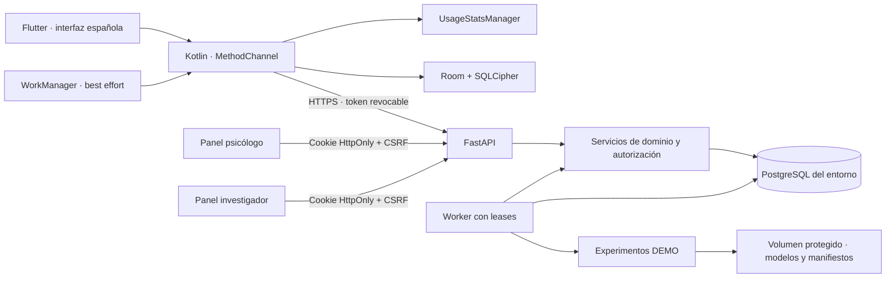
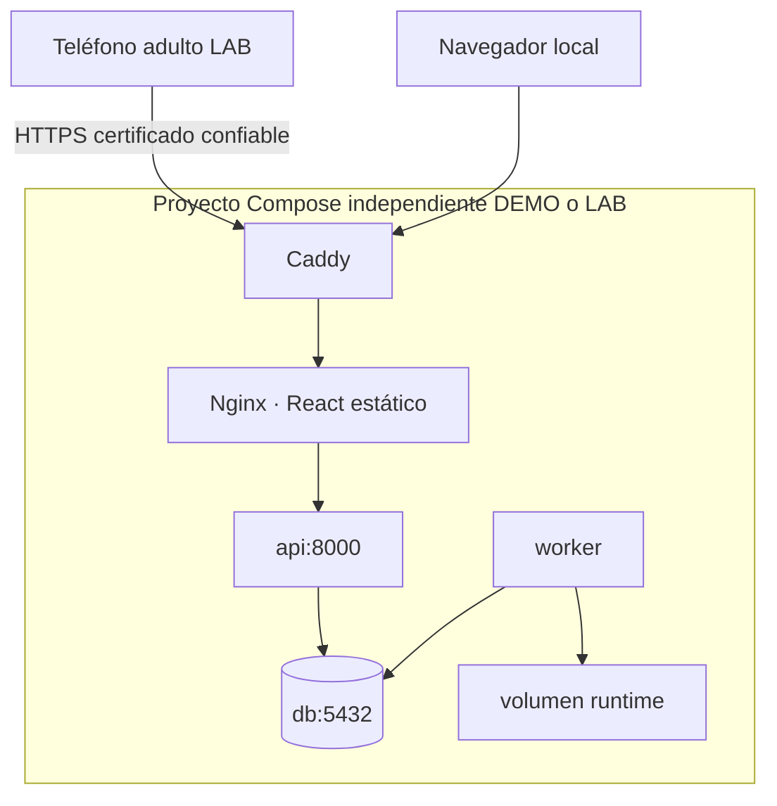

# Arquitectura del laboratorio

Proyecto independiente `acompana-escolar`. El stack sigue la especificación: Flutter/Kotlin, React/TypeScript/Vite, FastAPI, SQLAlchemy/Alembic y PostgreSQL, con worker y experimentos XGBoost/SHAP separados de peticiones HTTP. SQLite es una alternativa explícita **solo para DEMO local y tests**, útil en esta máquina sin Docker. No acredita funcionamiento de PostgreSQL ni sus bloqueos.

`infra/compose.yaml` usa perfiles `demo`/`lab` y nombres de proyecto diferentes, por lo que las redes, bases y volúmenes son distintos. Una tabla `environment_guard` impide abrir con APP_MODE contrario una base inicializada. El modo no viene del navegador. El servidor valida procedencia; DEMO rechaza `android_usage_events`, LAB rechaza `synthetic_generator`. No existe modo producción.

El servidor conoce al participante a partir del token de dispositivo, no de un participant_id del cliente. Las asignaciones limitan cada lectura/transición del psicólogo. Administradores no heredan permisos del investigador ni del psicólogo. Las cuentas se crean por CLI, con un solo rol explícito.

Las claves de idempotencia se asocian al actor, ruta y hash del contenido. Las peticiones del mismo actor se serializan con bloqueo de fila en PostgreSQL. Los casos usan versiones optimistas. Eventos, respuestas, features, evaluaciones y auditorías no se editan a través del ORM: un nuevo cálculo o decisión crea otro registro. La retención/borrado usa un camino SQL explícito en el worker.

Los jobs se reclaman con `FOR UPDATE SKIP LOCKED`, intento y lease de 30 minutos. Hasta tres intentos; la siguiente ejecución puede recuperar un lease vencido. Ese límite está pensado para estos experimentos pequeños. Procesos más largos requieren heartbeat/extensión del lease antes de usarlos. Una salida de entrenamiento es un artefacto UBJ generado internamente; no se cargan pickle externos.

No hay Redis, Celery, Firebase, servicios externos de analítica ni envío de datos de participantes a LLM. Las notificaciones son eventos persistentes de bandeja. El escalamiento de 24 horas se simula internamente, sin enviar mensajes.
